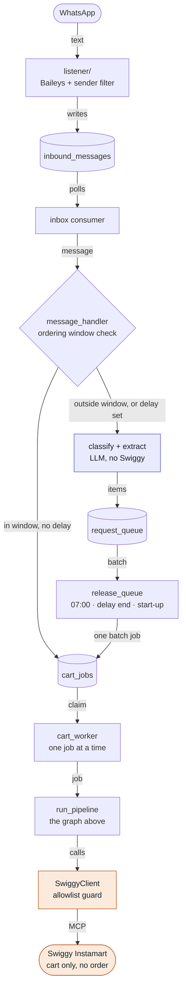

# Agent graph

The order pipeline is a LangGraph `StateGraph` of six nodes. The source of truth is
`agent/src/chat2cart/pipeline/graph.py` (`NODES`, `build_graph`, the three routing functions) and
`agent/src/chat2cart/pipeline/nodes.py`. This page must match them: any change to the nodes, their
order, their routing, the state, or what a node calls updates this page in the same pull request.

## Pipeline nodes

Solid arrows are the main path. Dashed arrows are shortcut routes chosen by a routing function.

```mermaid
flowchart LR
    START([START])
    classify["<b>classify</b><br/>LLM · intent label"]
    extract["<b>extract</b><br/>LLM · item list"]
    apply_rulebook["<b>apply_rulebook</b><br/>rule book · no LLM"]
    resolve["<b>resolve</b><br/>Swiggy search · read"]
    merge_cart["<b>merge_cart</b><br/>Swiggy cart · write"]
    report["<b>report</b><br/>RunReport + summary"]
    END([END])

    START -->|chat message| classify
    START -.->|"batch job: items already extracted"| apply_rulebook
    classify -->|order / mixed| extract
    classify -.->|"general / unsure"| report
    extract -->|items| apply_rulebook
    apply_rulebook -->|"items + rules"| resolve
    resolve -->|"resolved, at least 1"| merge_cart
    resolve -.->|"nothing resolved"| report
    merge_cart -->|merge_result| report
    report --> END

    classDef llm fill:#E9EAFB,stroke:#4A4FD0,color:#15202B
    classDef swiggy fill:#FCEBDD,stroke:#B84A13,color:#15202B
    classDef code fill:#EAEEF2,stroke:#7A8997,color:#15202B
    class classify,extract llm
    class resolve,merge_cart swiggy
    class apply_rulebook,report code
```

Colours: indigo calls the language model, orange talks to Swiggy through `SwiggyClient`, grey is plain code.

| Node | Reaches out to | State in → out | Behaviour |
| --- | --- | --- | --- |
| `classify` | Language model, structured output | `text` → `intent`, `order_text` | Labels the message order, general, mixed or unsure. A mixed message keeps only its grocery part. |
| `extract` | Language model, structured output | `order_text` → `extracted` | The model may only return a list of items. Each item is tagged with the message ids it came from. |
| `apply_rulebook` | The rule book file | `extracted` → `preferenced`, `skipped` | Merges repeated names, attaches brand, size, quantity and substitution rule. No rule means skipped as `no_rule`. |
| `resolve` | Swiggy: `search_products`, `your_go_to_items`, `get_orders` | `preferenced` → `resolved`, `skipped` | Picks exactly one in-stock variant per item, or skips it (`no_match`, `out_of_stock`, `ambiguous`, `inexact_conversion`). |
| `merge_cart` | Swiggy: `get_cart`, `update_cart`, `get_cart` | `resolved` → `merge_result` | Reads the cart, keeps every line, adds new items (larger quantity wins), writes once, reads back and reports differences. A dry run writes nothing. |
| `report` | Notification channel | everything → `report` | Builds the `RunReport`. Sends the cart summary only when a cart was written. |

Routing functions in `graph.py`:

- `_start_at`: items already extracted (an overnight batch) go to `apply_rulebook`, otherwise to `classify`.
- `_after_classify`: `order_text` set goes to `extract`, otherwise to `report`.
- `_after_resolve`: at least one resolved item goes to `merge_cart`, otherwise to `report`.

## How a message reaches the graph

Square-cornered cylinders are SQLite tables. A message inside the window becomes a cart job at once. Outside
the window, or with a batching delay, it is only understood and queued, and one release turns the queue into a
single batch job that enters the graph at `apply_rulebook`. If Swiggy reports the address is not serviceable,
the requests go back into `request_queue`.

## Guardrails

- The model only produces data. Swiggy tools are never bound to it; code decides every Swiggy call.
- Every Swiggy call goes through `SwiggyClient`, which allows only the tools in `swiggy/allowlist.py`.
- Checkout, payment and order-confirmation tools are never called. The pipeline ends at the cart.
- An ambiguous, unavailable or unruled item is skipped with a reason, never guessed into the cart.
- The merge keeps the larger quantity instead of adding, so a retried job does not double an item.
